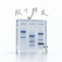

<p align="center">
  
</p>

# GelFriend · 胶个朋友

面向 Mac 的胶图查看与分析软件。先看清胶图，再一步一步完成泳道设置、条带核对、Marker 标定和结果导出。

[下载最新版](https://github.com/OceanLip04/GelFriend/releases/latest) · [完整使用说明](README_使用说明.md) · [Agent 接口](Docs/Agent接口-v2.4.0.md) · [问题反馈](https://github.com/OceanLip04/GelFriend/issues)

**当前版本：2.4.0（27）｜Apple 芯片 Mac｜macOS 13 或更新版本**

## 下载与使用

1. 打开 [Releases 下载页](https://github.com/OceanLip04/GelFriend/releases/latest)，下载 `GelFriend-v2.4.0-Mac.zip`。
2. 解压后将 `GelFriend-v2.4.0.app` 放入“应用程序”文件夹，打开软件。
3. 选择核酸电泳、蛋白电泳或 Western blot 等实验类型，再打开 SGD、TIFF 或 PNG 图像。已有实验可直接打开 `.gelproject` 项目。

发布包采用本地临时签名，尚未进行 Apple 开发者公证；首次打开可能出现系统安全提示。目前没有 Intel Mac、Windows 或 iOS 安装包。使用应用本身无需 Python、Node 或联网。

## 可以做什么

- **大图查看**：专注视图、完整/铺满、鼠标缩放与拖动、任意角度旋转、反相、黑白点和 Gamma 调整。查看与分析共用方向和视野。
- **泳道设置**：手动框选首个、第二个和最后一个泳道生成等距泳道；生成后可逐条调整、删除空泳道，分别指定 Marker。
- **条带核对**：自动检测候选，直接在积分曲线上框选新增、调整边界、移动或删除条带；支持撤销与重做。
- **标定与定量**：自建 Marker 库、显式匹配标准带、DNA bp / 蛋白 kDa 标定、独立已知量标准及 Western 归一化。
- **项目与导出**：保留原始像素和分析设置，保存可继续编辑的项目，导出显示图、数据与带核对状态的报告；另有批量图像调整/导出。
- **Agent 操作**：本机 MCP 与命令行共 28 项接口，可获取胶图图片、曲线及结果，操作泳道、条带和标定，保存与导出。

图像显示调整不改变原始像素。自动候选与人工核对有独立状态；待核对、待更新内容在报告中保留草稿提示。算法与验证范围见 [验证记录](Docs/算法与验证.md)。此仓库只包含胶图应用；流式细胞分析已独立，不提供 FCS 导入。

## Agent 接入

先在软件顶部菜单选择 **Agent → 开启本机 Agent 接口**，然后在支持本机 MCP stdio 的客户端中配置：

```json
{
  "mcpServers": {
    "gelfriend": {
      "command": "/Applications/GelFriend-v2.4.0.app/Contents/MacOS/gelfriend-agent",
      "args": ["--stdio"]
    }
  }
}
```

按实际安装位置修改路径。每次写入要求当前文档和上下文版本，用户切换通道或编辑后旧指令会失效。接口默认关闭，仅同一用户的本机进程可连接，不开放网络端口。云端 ChatGPT 不会自动连接本机程序；客户端需要相应的本机工具能力。接入外部模型后的数据处理由客户端配置决定。

详见 [接口文档](Docs/Agent接口-v2.4.0.md)、[机器可读参数](Agent/api.json) 和 [示例程序](Agent/example.py)。

## 从源码构建

需要 macOS、Xcode Command Line Tools（Swift 编译器）。

```sh
git clone https://github.com/OceanLip04/GelFriend.git
cd GelFriend
./build.command
```

生成 `dist/GelFriend-v2.4.0.app` 和 `dist/GelFriend-v2.4.0-Mac.zip`。应用由 Swift / AppKit 原生外壳与本地 WKWebView 分析工作区组成，运行资源随包提供。

## 测试

除 Swift 外，测试还需要 Python 3、Node.js（22.22.2+ 或满足依赖要求的更新版本）和 npm：

```sh
./test-analysis.command
```

首次运行从 npm 锁定文件安装测试依赖；依赖就绪后测试在本机运行。共 197 项自动检查，覆盖图像解析、数值、倾斜几何、工作区、流程、项目及 Agent。公开测试用的 SGD 由 [确定性生成器](Tests/make_public_fixture.py) 临时生成，包含人工构造的泳道和条带，不含真实实验像素；开发期参考图和个人文件不随仓库发布。

原生 Agent 端到端检查需要专门的测试应用副本，脚本会替换该副本的当前工作区。请先阅读 [验收记录](Docs/Agent接口验收-v2.4.0.md)，不要对正在编辑的实验运行集成脚本。组件测试或合成数据通过并不等于湿实验准确性验证。

## 项目结构

| 目录 | 内容 |
| --- | --- |
| `Sources/` | 原生窗口、SGD 解析、图像导入、批量和 Agent 服务 |
| `Analysis/` | 胶图界面、分析算法、项目状态和交互 |
| `Agent/` | API Schema、MCP 配置和调用示例 |
| `Tests/` | 自动检查与合成输入生成器 |
| `Docs/` | 使用、流程、算法与历史验收说明 |

部分文档记录拆分前的历史版本与本机验收，当前功能以本页、当前源码及对应版本说明为准。当前尚未指定开源许可证。
